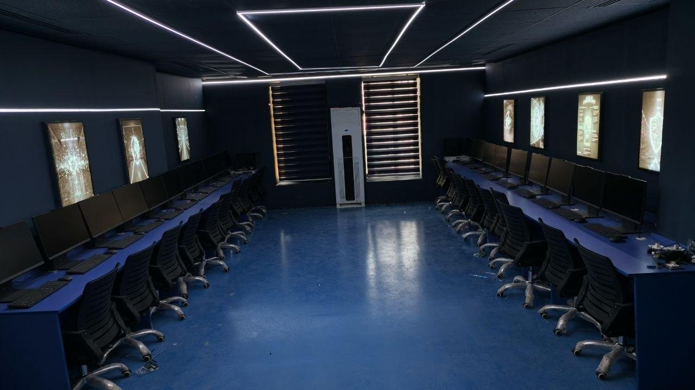

# تجهيز وتأهيل مختبر الأمن السيبراني

مشروع من تنفيذ فريق **سايبر آي كيو (Cyber IQ)** — الجامعة العراقية، كلية الهندسة، قسم هندسة الشبكات والأمن السيبراني.

## نبذة

بناء البنية التحتية التقنية لمختبر الأمن السيبراني في القسم من الصفر، لتوفير بيئة مختبرية متكاملة تساعد الطلبة على التطبيق العملي والتدريب في مجالات الأمن السيبراني والشبكات والأنظمة والخوادم.

## معلومات المشروع

| البند | التفصيل |
|---|---|
| عدد الحاسبات | 30 حاسبة |
| عدد السيرفرات | 2 سيرفر |
| مدة التنفيذ | أسبوع إلى عشرة أيام |
| طبيعة العمل | Hardware · Networking · Servers · Software · Configuration · Testing |

## نطاق العمل

- تجهيز وتركيب 30 حاسبة وربطها بالشبكة، وتوفير منفذ LAN لكل حاسبة.
- إنشاء البنية التحتية لشبكة المختبر، وتمديد وربط كابلات الشبكة، وتجهيز المنافذ.
- تجميع وتركيب مكونات سيرفرين، وإعدادهما وبرمجتهما وربطهما بالشبكة والإنترنت.
- إعداد وبرمجة الراوتر، وربط جميع الأجهزة، وإجراء الفحوصات والاختبارات النهائية.

## النتائج

مختبر أمن سيبراني متكامل جاهز للاستخدام الأكاديمي والتدريبي، بـ 30 حاسبة وسيرفرين وبنية شبكة كاملة.

## فريق العمل

10 أعضاء من فريق Cyber IQ، بتوزيع المهام والتعاون المشترك.

---

**EN:** *Cybersecurity Lab Setup* — Cyber IQ built the department's cybersecurity lab from scratch: 30 PCs, 2 servers, full LAN infrastructure, cabling, server assembly/configuration, router setup and testing. Delivered in ~1–10 days by a 10-member team. A ready academic/training environment.

Part of [Cyber IQ — CYBERIQ-HQ](https://github.com/CYBERIQ-HQ)

